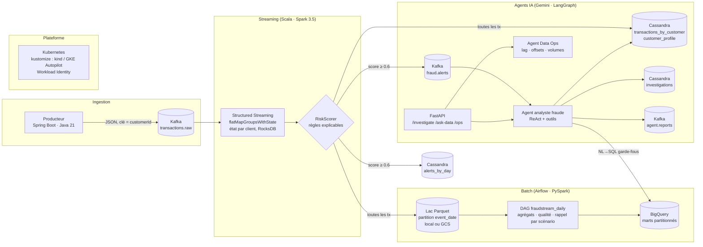

# Architecture

## Vue d'ensemble

## Choix de conception et justification

| Décision | Pourquoi | Alternative écartée |
|---|---|---|
| **Clé Kafka = customerId** | Garantit l'ordre par client dans une partition : indispensable pour « voyage impossible » et « card testing » | Clé aléatoire (meilleur équilibrage, mais ordre perdu) |
| **`flatMapGroupsWithState` + RocksDB** | État par client borné (fenêtre 10 min, 10 devices, moyenne incrémentale) ; timeout 24 h en temps événement ; RocksDB pour ne pas saturer la heap | Jointure stream-stream (plus coûteuse, moins expressive) ; `mapGroupsWithState` (une sortie par groupe) |
| **Scoring par règles pures (Scala, sans Spark)** | Testable unitairement en millisecondes, explicable au métier et à l'agent IA ; la signature `process(tx, state)` permet de brancher un modèle ML plus tard | Modèle ML dès le POC (boîte noire, pas de vérité terrain réelle) |
| **Cassandra (serving) + lac Parquet + BigQuery (analytique)** | Chaque pattern d'accès a son moteur : lookup par client < 10 ms, scan analytique illimité, historique bon marché | Tout dans BigQuery (latence inadaptée au temps réel) ; tout dans Cassandra (pas d'analytique) |
| **BigQuery alimenté par Airflow depuis le lac** (pas de streaming insert) | Reste dans le palier gratuit, charge idempotente par partition, un seul chemin d'écriture à auditer | Connecteur Spark→BigQuery direct (dispo en option `BQ_DIRECT_WRITE`, coûts de streaming) |
| **Alertes via Kafka → agent** | Découplage : l'agent peut être arrêté, mis à l'échelle ou remplacé sans toucher au streaming ; rejouable | Appel HTTP synchrone depuis Spark (couplage, latence dans le micro-batch) |
| **Agent ReAct + outils, sortie JSON validée Pydantic, repli sûr** | Le LLM raisonne mais n'écrit rien : lecture seule, SQL filtré (`guard_sql`), jamais `BLOCK_CARD` sur sortie illisible | Prompt unique sans outils (pas de vérification) ; agent avec droits d'écriture |
| **`isFraudLabel` retiré avant le LLM** | La vérité terrain synthétique ne doit jamais fuiter vers le modèle : sinon l'évaluation ne vaut rien | — |
| **Kustomize base + overlays** | Mêmes manifests sur kind (gratuit) et GKE (crédits) ; Workload Identity évite toute clé JSON dans le cluster | Helm (plus lourd pour 6 ressources) |

## Garanties de livraison

| Chemin | Garantie | Mécanisme |
|---|---|---|
| Kafka → Spark | at-least-once | offsets dans le checkpoint |
| Spark → lac Parquet | exactly-once | checkpoint + commit log des fichiers |
| Spark → Cassandra | effectivement exactly-once | écritures idempotentes (clé primaire = transactionId) |
| Spark → `fraud.alerts` → agent | at-least-once, dédoublonné | `alertId = alert-<transactionId>`, vérification dans `investigations` avant enquête |
| Airflow → BigQuery | idempotent | `WRITE_TRUNCATE` sur la partition du jour |

## Dimensionnement et chiffres à mesurer

Les paramètres ci-dessous sont ceux du code ; les mesures (débit max, latence) sont **à relever lors de la première
exécution** et à reporter dans le README (section « Résultats ») — ne pas annoncer de chiffres non mesurés en entretien.

- Producteur : 20 lots/s par défaut (`PRODUCER_RATE_PER_SECOND`), 3 partitions ; monter le débit via `POST /api/producer/rate/{n}` et observer le lag dans Kafka UI.
- Spark local[*] : micro-batch 5 s (`TRIGGER_SECONDS`), watermark 5 min, `maxOffsetsPerTrigger` 5 000. Latence bout-en-bout attendue ≈ trigger + durée du batch : à mesurer avec `eventTime` vs `created_at` de l'enquête.
- Cassandra : TTL 30 j sur l'historique ; `customer_profile` = 1 ligne/client, upsert.
- BigQuery : partition + cluster `customerId, isAlert` ; expiration 60 j ; `maximum_bytes_billed` 1 Go par requête d'agent.
- Gemini Flash : `max_tool_calls` 8 ; latence par enquête et nombre moyen d'outils sont exposés dans `investigations.latency_ms` et `tool_calls`.
